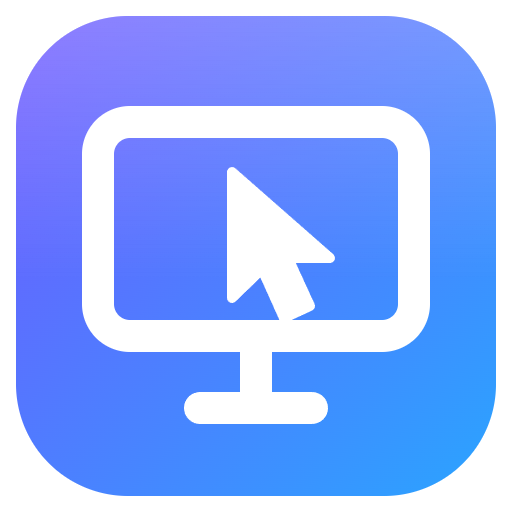

# Remoto

Desktop remoto in stile AnyDesk per Windows: ogni postazione ha un **ID a 9 cifre**, può
controllare altre postazioni e farsi controllare. Ogni connessione parte **solo con conferma
a video** sul PC controllato: niente accesso non presidiato, niente password memorizzate (così
non dà problemi ad antivirus e VPN). Schermo, audio, **microfono di chi si collega**, input,
file e chat viaggiano **direttamente tra i due PC** (WebRTC, cifratura DTLS-SRTP); un piccolo
**server ID** self-hosted serve solo a trovarsi via Internet. In rete locale funziona anche
senza server e **senza Node**. Un **servizio di sistema facoltativo** aggiunge il controllo
completo (finestre di amministratore, UAC, schermata di blocco, Ctrl+Alt+Canc).



## Funzionalità

| Area | Cosa fa |
|---|---|
| Connessione | per ID (via server o rete locale), per indirizzo IP/nome host, rilevamento automatico delle postazioni in LAN |
| Accesso | **solo con conferma**: finestra **Accetta/Rifiuta** con i permessi da concedere, elenco di ID autorizzati. Nessun accesso non presidiato né password |
| Schermo | P2P (fallback TURN), più monitor, qualità *Ottimale / Bilanciata / Velocità*, codec H.264/VP9/VP8/AV1, adatta o dimensione originale, schermo intero, statistiche (FPS, banda, latenza, LAN/P2P/relay) |
| Input | mouse (anche rotella orizzontale), tastiera per scancode (vale il layout del PC remoto), *Tasti speciali* (Win, Win+R, Alt+Tab, Ctrl+Maiusc+Esc, Alt+F4, **Ctrl+Alt+Canc** col servizio…), digitazione del testo degli appunti, sola visualizzazione |
| Audio | audio di sistema del PC remoto **e microfono di chi si collega** riprodotto sul PC remoto: con un cavo audio virtuale le app del PC remoto (es. Teams) lo ricevono come microfono |
| Controllo completo | servizio di sistema facoltativo: finestre di amministratore, richieste **UAC**, **schermata di blocco** e **Ctrl+Alt+Canc**; si installa dall'app (richiede UAC) |
| Appunti | sincronizzazione nei due sensi di testo e immagini |
| File | file manager a due pannelli, upload/download di file e cartelle, nuova cartella, rinomina, elimina, trascinamento sul video o da Esplora risorse, modalità **solo trasferimento file** |
| Collaborazione | chat, **lavagna** (penna ed evidenziatore che sfuma) disegnata sullo schermo remoto |
| Privacy | **modalità privacy**: chi è davanti al PC remoto vede nero, chi controlla vede il desktop; blocco di mouse e tastiera locali (richiede amministratore) |
| Sessione | registrazione video (WebM), screenshot, audio di sistema, riavvio del PC remoto con riconnessione automatica, blocco di Windows a fine sessione |
| Rubrica | recenti, rubrica con nomi e note, stato online, **Wake-on-LAN** |
| Lato controllato | pannello di sessione sempre visibile (chi è collegato, permessi modificabili al volo, chat, disconnetti), icona nell'area di notifica, **registro accessi** |
| Sistema | avvio con Windows nell'area di notifica, tema chiaro/scuro, installer NSIS e **portable in .zip** (dati accanto all'eseguibile, niente installazione), `--server` senza Node |

## Avvio rapido

1. Installa `dist/Remoto-Setup-1.1.0.exe` (l'installer aggiunge la regola del Windows Firewall),
   oppure estrai `dist/Remoto-1.1.0-portable-win64.zip` e avvia `Remoto\Remoto.exe`: niente
   installazione, niente Node, i dati restano nella cartella `Remoto-dati` accanto all'eseguibile.
   Se al primo avvio Windows chiede di consentire Remoto nel firewall, in rete locale funziona
   comunque (anche rispondendo *Annulla*): vedi [Rete locale e firewall](#rete-locale-e-firewall).
2. Nella finestra principale trovi l'**ID di questa postazione** (riquadro in alto a sinistra).
3. Sull'altro PC scrivi quell'ID (o l'indirizzo IP) nella barra in alto e premi **Connetti**.
4. Sul PC controllato compare la richiesta: scegli i permessi e premi **Accetta**.

In **rete locale** non serve altro: le postazioni si trovano da sole (scheda *Rete locale*).
Per collegarti **via Internet** (PC su reti diverse) serve un server ID: vedi
[Fuori dalla rete locale](#fuori-dalla-rete-locale-via-internet); è il ruolo che i server di
AnyDesk e RustDesk svolgono per i loro client.

### Rete locale e firewall

In LAN la postazione che controlla prova insieme tutte le strade verso l'altra (tutti i suoi
indirizzi, se ne ha più d'uno) e usa la prima che risponde:

1. **TCP diretto** sulla porta 47801 dell'altro PC;
2. **segnalazione UDP** sulla porta del rilevamento (47802), che funziona anche quando il Windows
   Firewall dell'altro PC blocca le connessioni in entrata (al primo avvio qualcuno ha premuto
   *Annulla*, oppure la rete è *Pubblica* e Remoto è consentito solo sulle reti private). Ogni
   postazione annuncia la sua presenza in broadcast ogni 2,5 s e Windows lascia passare per 3 s le
   risposte a un broadcast: la richiesta arriva lì, e da quel momento il traffico è "di ritorno" per
   entrambi i firewall. Schermo e input viaggiano poi su WebRTC, che i firewall li attraversa da sé.

Se la postazione si vede nell'elenco ma nessuna strada risponde, Remoto lo dice esplicitamente
(firewall, antivirus o VPN dell'altro PC). L'indirizzo mostrato nella schermata principale è quello
della rete principale; le schede virtuali (Hyper-V/WSL, VirtualBox, VPN…) sono elencate per ultime
in *Impostazioni › Rete*, perché dagli altri PC di solito non si raggiungono.

### Prestazioni

Misurato con `node test/e2e/dev/latency-probe.mjs` (stesso PC, schermo 2560×1440): dallo schermo
del PC controllato al video di chi controlla passano **~50 ms** (prima erano ~180). Il guadagno viene
da tre cose: il video si mostra appena decodificato, senza il buffer anti-jitter (field trial di
WebRTC in `src/main/chromium-flags.js`); la cattura dello schermo a 60 fps (Windows Graphics Capture
consegna immagini vecchie di circa due periodi di cattura); il preset *Bilanciata* che privilegia la
reattività (con il contenuto "schermo" i fotogrammi grandi si accodavano nell'invio). Per leggere
documenti con il testo più nitido c'è *Qualità ottimale*. L'input arriva in meno di 1 ms: il ritardo
che si percepisce sul puntatore è quello del video.

### Controllo completo (finestre di amministratore, UAC, blocco, Ctrl+Alt+Canc)

Di base Remoto controlla le app normali con `SendInput`. Per controllare anche le richieste
**UAC**, le finestre avviate **come amministratore** e la **schermata di blocco** — e per
inviare **Ctrl+Alt+Canc** — installa il servizio di sistema da *Impostazioni › Sicurezza ›
Controllo completo* (comparirà la richiesta UAC). Da quel momento, quando parte una sessione che
hai accettato, input e cattura passano dal servizio e superano i limiti di sistema; sul desktop
protetto chi controlla continua a vedere lo schermo. Il servizio accetta comandi solo da Remoto
installato in *Programmi* e solo durante una connessione accettata. Alcuni antivirus possono
segnalare un servizio che simula tastiera e mouse: è previsto. Disponibile solo nella versione
installata (non nella portable). Vero HID a livello hardware (driver kernel) non è incluso.

### Microfono di chi si collega (parlare nelle app del PC remoto)

Puoi usare il microfono del **tuo** PC nelle app del **PC remoto** (es. una call Teams sul PC
remoto con le cuffie collegate al tuo portatile). Scegli il microfono dalla barra audio della
sessione. Perché Teams & co. sul PC remoto lo vedano come un microfono serve, **una volta**, un
cavo audio virtuale sul PC remoto (per esempio [VB-CABLE](https://vb-audio.com/Cable/), gratuito):
Remoto riproduce la tua voce su "CABLE Input" e in Teams scegli "CABLE Output" come microfono.
Senza cavo la tua voce arriva comunque, ma solo agli altoparlanti del PC remoto. Si configura in
*Impostazioni › Audio*.

### Durante la sessione

Barra in alto, da sinistra: monitor remoto, qualità, adattamento, tasti speciali, sola
visualizzazione, appunti, audio, chat, file, lavagna, altre azioni (screenshot,
registrazione, privacy, blocco input, blocco/riavvio del PC remoto, informazioni), statistiche,
schermo intero, **Disconnetti**.

| Scorciatoia | Azione |
|---|---|
| `Ctrl` + `Alt` + `Maiusc` + `F` | schermo intero |
| `Ctrl` + `Alt` + `Maiusc` + `V` | sola visualizzazione |
| `Ctrl` + `Alt` + `Maiusc` + `S` | screenshot |

Trascina file dal tuo Esplora risorse sul video per copiarli sul Desktop remoto. Screenshot e
registrazioni finiscono in `Immagini\Remoto` e `Video\Remoto`.

## Fuori dalla rete locale (via Internet)

Su Internet due PC non possono trovarsi da soli: in LAN si annunciano in broadcast, ma fuori
ognuno sta dietro il proprio router (NAT) e non conosce l'indirizzo dell'altro. AnyDesk e RustDesk
risolvono con i loro server pubblici; Remoto con un **server ID** che è tuo (vedi sotto). Il server
serve solo a trovarsi e a scambiarsi i dati per la connessione: schermo, input e file passano
direttamente tra i due PC, cifrati, e il server non li vede. Con il server anche il firewall non è
più un problema: entrambi i PC si collegano *in uscita*, come fa RustDesk.

Va bene anche la versione **portable**: su entrambi i PC (chi controlla e chi è controllato) si
inserisce l'indirizzo del server in *Impostazioni › Rete* e ci si collega per ID.

| Soluzione | Cosa serve | Note |
|---|---|---|
| **Server ID su una VPS** (Docker + coturn, vedi sotto) | un server con IP pubblico, anche gratuito (es. Oracle Cloud *Always Free*) | la più affidabile: con TURN passa anche dalle reti più chiuse (aziendali, 4G) |
| **Server integrato** su un PC sempre acceso | aprire la porta 47800/TCP sul router di quel PC | non funziona se il provider usa il CGNAT (IP pubblico condiviso, frequente su fibra e 4G) |
| **Rete privata virtuale** (Tailscale, ZeroTier) | installarla sui due PC | nessun server di Remoto: ci si collega per indirizzo IP della rete virtuale, come in LAN |

## Server ID

Il server registra gli ID (ognuno legato a un segreto della postazione, così nessuno può
"rubarlo"), inoltra i messaggi di segnalazione e fornisce le credenziali STUN/TURN. **Non vede
mai schermo, input o file.** Tre modi per averlo:

**1. Integrato nell'app.** Su un PC sempre acceso: *Impostazioni › Rete › Server integrato*.
Gli altri PC useranno come indirizzo del server `IP-di-quel-PC:47800` (per l'uso via Internet
serve aprire la porta 47800/TCP sul router).

**2. Con Node.js** (≥ 20) su un server o una VPS:

```bash
npm install --omit=dev
```

```bash
node src/server/cli.js --port 47800 --data ./data
```

`node src/server/cli.js --help` elenca tutte le opzioni (anche come variabili `REMOTO_*`).

**3. Con Docker, insieme a coturn** (consigliato per Internet): nella cartella `server/` copia
`.env.example` in `.env`, imposta `PUBLIC_HOST` e `TURN_SECRET`, poi (sempre da `server/`):

```bash
docker compose up -d --build
```

Porte da aprire: `47800/tcp` (server ID), `3478/tcp+udp` e `49160-49200/udp` (TURN).
Per avere `wss://` con certificato automatico metti davanti Caddy (`server/Caddyfile.example`)
e avvia il server con `REMOTO_TRUST_PROXY=1`.

Nei client: *Impostazioni › Rete › Indirizzo del server* = `remoto.miodominio.it:47800`
(oppure `wss://remoto.miodominio.it` dietro Caddy). Stato e numero di postazioni online sono
visibili su `http://server:47800/` e `/health`.

### Porte usate dai client

| Porta | Uso |
|---|---|
| 47801/tcp | connessioni dirette in LAN (se occupata si usano le successive) |
| 47802/udp | rilevamento delle postazioni in LAN (broadcast) e segnalazione LAN quando il TCP è bloccato |
| UDP effimere | media WebRTC |

## Sicurezza

- **Cifratura end-to-end**: schermo, audio, microfono, input, file, appunti e chat viaggiano su
  WebRTC (DTLS-SRTP) direttamente tra le postazioni o, se serve, attraverso TURN (che vede solo dati cifrati).
- **Solo con conferma**: ogni connessione compare in una finestra sul PC controllato e parte solo
  se qualcuno la accetta. Non esiste accesso non presidiato né password di accesso: questo evita i
  falsi positivi di antivirus/VPN e non lascia segreti sul disco.
- **Permessi** decisi da chi è davanti al PC (anche durante la sessione, dal pannello) e applicati
  dal processo principale, non dall'interfaccia.
- **Servizio di controllo completo** (facoltativo): gira come LocalSystem ma accetta comandi solo
  su una named pipe con ACL, solo da `Remoto.exe` in *Programmi*, nella stessa sessione e solo
  durante una connessione accettata; alla disinstallazione ripristina il criterio di Ctrl+Alt+Canc.
- **Identità**: con il server l'ID di chi si collega è verificato; in connessione diretta LAN è
  solo *dichiarato* (la richiesta lo segnala, il registro accessi lo riporta).
- **Electron blindato**: contextIsolation, sandbox, nessun accesso Node dalle pagine, CSP
  restrittiva, navigazione e popup bloccati, ogni canale IPC autorizzato per tipo di finestra.
- Modello di fiducia: il server ID è tuo. Un server malevolo non può leggere i dati né ottenere
  la password, ma potrebbe tentare un attacco *man-in-the-middle* sulla segnalazione: usa un
  server che controlli.

## Limiti noti

- **Ctrl+Alt+Canc**, schermata di blocco e finestre UAC si controllano **solo** con il servizio
  *Controllo completo* installato (vedi sopra); senza servizio Remoto comanda solo le app normali.
- Senza il servizio, le finestre di programmi avviati **come amministratore** si controllano solo
  se anche Remoto è avviato come amministratore (lo stesso vale per il *blocco dell'input locale*).
- Il servizio **non** è un driver HID a livello kernel: emula tastiera e mouse con `SendInput` da
  contesto SYSTEM. Copre UAC/blocco/finestre elevate, non eventuali protezioni anti-cheat.
- Dopo un **riavvio remoto** la riconnessione funziona se Windows esegue l'accesso automatico e
  Remoto parte con Windows.
- Il PC controllato deve essere Windows; da macOS/Linux l'app funziona come postazione che controlla.
- Il microfono di chi si collega è udito come microfono dalle app del PC remoto solo con un cavo
  audio virtuale installato lì (vedi sopra).
- Le registrazioni WebM non hanno l'indice di durata (si riproducono, ma lo scorrimento può essere impreciso).
- Senza TURN alcune reti (NAT simmetrici, firewall aziendali) non permettono la connessione diretta.

## Risoluzione dei problemi

| Sintomo | Cosa fare |
|---|---|
| "Nessun server ID connesso e postazione non trovata in rete locale" | configura un server ID oppure collegati per indirizzo IP |
| "Impossibile raggiungere la postazione remota" | Remoto non è aperto sull'altro PC, l'indirizzo è sbagliato (quello giusto è nella schermata principale dell'altro PC, non uno di una scheda virtuale) o i PC sono su reti diverse: serve un server ID |
| "La postazione si vede in rete locale ma non accetta la connessione" | firewall, antivirus o VPN dell'altro PC: prova il verso opposto, consenti Remoto nel firewall di quel PC (anche per le reti *Pubbliche*) o usa un server ID |
| La connessione resta su "Avvio della connessione diretta cifrata" e poi fallisce | rete che blocca il P2P: configura TURN (docker-compose) |
| Le postazioni in LAN non si vedono | consenti Remoto nel Windows Firewall (reti private) o collegati per IP |
| Non riesco a cliccare in alcune finestre del PC remoto | sono elevate (UAC/amministratore): installa il *Controllo completo* (Impostazioni › Sicurezza) sul PC remoto |
| La richiesta di connessione non compare o la connessione cade subito dopo | un antivirus, un firewall o la VPN su uno dei due PC sta bloccando Remoto: aggiungi un'eccezione. Il dettaglio è nel registro e nella finestra di sessione |
| Il microfono arriva ma Teams non lo vede | installa un cavo audio virtuale sul PC remoto (VB-CABLE) e scegli "CABLE Output" come microfono in Teams |
| Immagine scattosa | qualità *Velocità*, oppure prova un altro codec (Impostazioni › Visualizzazione) |
| Serve diagnosticare | *Impostazioni › Informazioni › Cartella dei log* (`%APPDATA%\Remoto\logs`; servizio: `%ProgramData%\Remoto\logs`) |

## Sviluppo

Requisiti: **Node.js ≥ 22.12** per `npm install` da zero (Electron 44 lo richiede per scaricare
il proprio binario) e per i test. Con `node_modules` già installato, `npm start` funziona anche
con Node 20. In questa cartella c'è un Node 24 portatile in `.tools/node` usato durante lo
sviluppo: puoi anteporlo al `PATH`, oppure installare Node 24 LTS e cancellare `.tools`.

```bash
npm install
```

```bash
npm start
```

Per provare due postazioni sullo stesso PC apri una seconda istanza con un profilo separato:

```bash
npm run start:b
```

| Comando | Cosa fa |
|---|---|
| `npm test` | 85 test unitari (ID, geometria, servizio, server, trasporti TCP/UDP con firewall simulato, sessioni, file, config…) |
| `npm run test:e2e` | 17 test end-to-end con due istanze reali e un server (sposta per un istante il mouse e lo rimette a posto) |
| `REMOTO_E2E_VISUAL=1 npm run test:e2e` | include la modalità privacy (oscura i monitor per circa un secondo) |
| `node test/e2e/dev/service-helper.mjs` | collaudo dell'helper del servizio in "modalità di prova" (richiede `npm run build:service`) |
| `node test/e2e/dev/qa-shots.mjs <cartella> [light\|dark]` | screenshot di tutte le schermate per il controllo visivo (video sfocato) |
| `node test/e2e/dev/latency-probe.mjs [secondi] [carico]` | misura la latenza schermo→video, la cattura, la codifica, il buffer del ricevitore e l'input |
| `npm run icons` | rigenera le icone da SVG |
| `npm run build:service` | compila il servizio C# in `build/service/` (serve .NET SDK 10) |
| `npm run dist` | compila il servizio, l'installer NSIS e lo zip portatile: in `dist/` solo i file da distribuire, gli intermedi in `out/` |
| `npm run dist:zip` | solo lo zip portatile (senza ricompilare il servizio) |
| `npm run server` | server ID in locale |

Il servizio di controllo completo è un progetto C# a sé (`service/RemotoService`, .NET 10,
self-contained): `npm run dist` lo compila e lo include nell'installer (`resources/service`).
Senza .NET SDK l'app funziona comunque, con il solo controllo via `SendInput`.

Variabili utili in sviluppo: `REMOTO_PROFILE_DIR` (cartella del profilo), `REMOTO_SERVER_URL`,
`REMOTO_NAME`, `REMOTO_DIRECT_HOST`/`REMOTO_DIRECT_PORT`, `REMOTO_DISCOVERY=0`, `REMOTO_MEDIA_DIR`.

### Struttura

```
src/
  shared/     moduli puri condivisi (ID, protocollo, permessi, geometria, rate limit, framing file…)
  server/     server ID (core riutilizzabile, registro, TURN, CLI, pagina di stato)
  main/       processo principale Electron
    sessions/   HostManager (sessioni in arrivo) e ViewerManager (in uscita)
    net/        server ID, connessioni dirette LAN (TCP e segnalazione UDP), rilevamento, indirizzi, Wake-on-LAN
    native/     SendInput & co. via koffi, mappa tasti → scancode, client del servizio (named pipe)
    features/   file, appunti, privacy/lavagna, azioni di sistema, gestione del servizio
  preload/    ponte IPC minimo
  renderer/   home, richiesta, pannello, sessione, engine (cattura e WebRTC), overlay
service/      RemotoService (C# .NET 10): servizio LocalSystem + helper di sessione per il controllo completo
test/
  unit/       node --test
  e2e/        Playwright + Electron; dev/ = strumenti di collaudo (latenza, screenshot, servizio, eseguibile)
server/       deploy del server ID: Dockerfile, docker-compose.yml con coturn, .env.example, esempio Caddy
scripts/      icone e raccolta dei file da distribuire
build/        risorse per l'installer (icone, regole del firewall); build/service = servizio compilato
docs/         specifica di progetto (architettura, protocolli, sicurezza)
dist/         solo i file da distribuire (zip portable, installer); archivio/ = versioni precedenti
out/          file intermedi di electron-builder (si possono cancellare)
.tools/       Node portatile usato in sviluppo
```

La specifica completa (architettura, protocolli di segnalazione e dei canali dati, modello di
sicurezza) è in [docs/progetto.md](docs/progetto.md).
